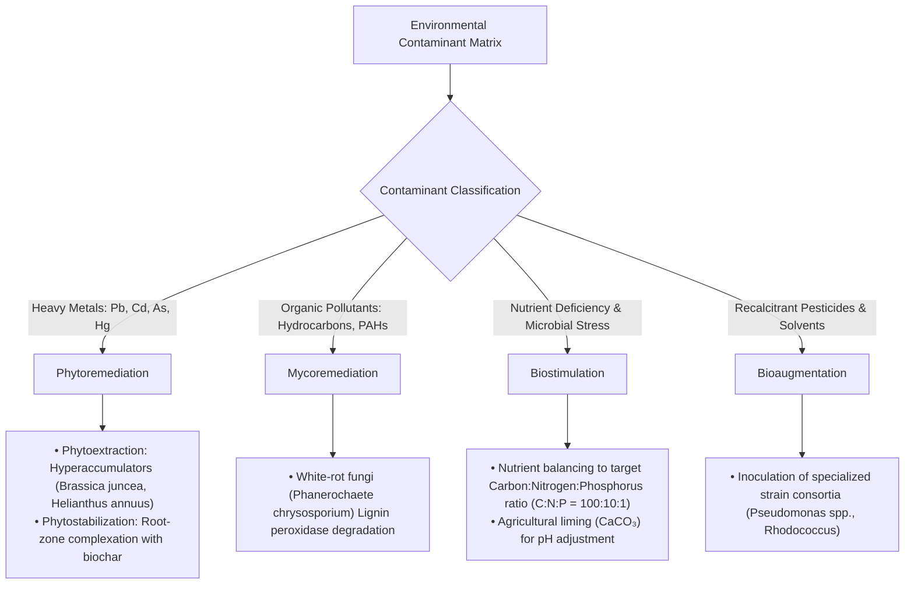
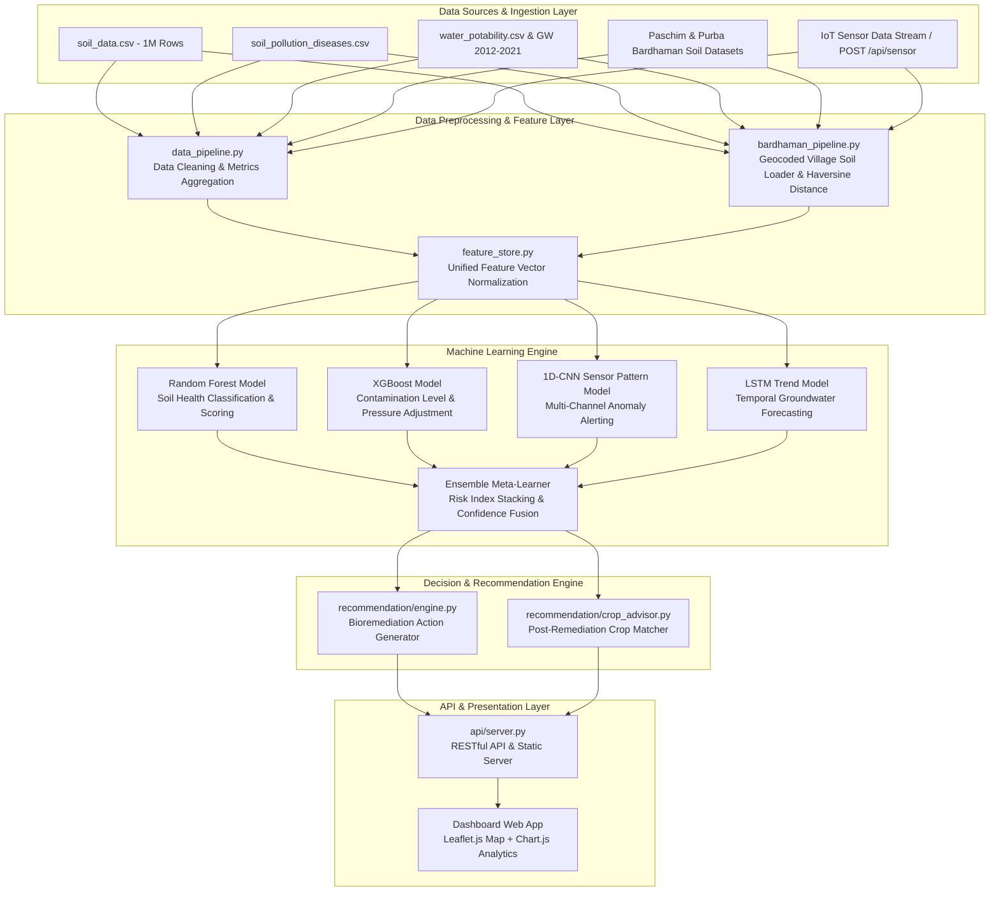
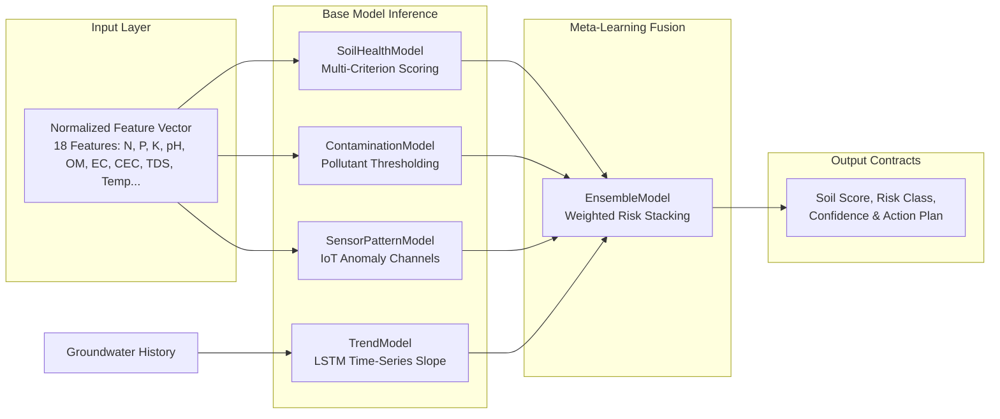
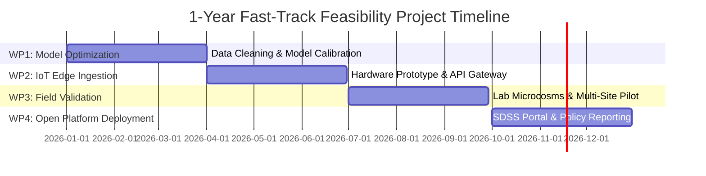

# Bioremediation Intelligence Platform: Integrated ML Engine and Spatial Decision Support System

> **Grant Proposal & Research Documentation**  
> **Target Program**: Fast-Track Feasibility & Field Validation Research Grant (DST / SERB / DBT / ICAR / EPA / Horizon Europe)  
> **Project Duration**: 1-Year Fast-Track Feasibility & Field Validation Project  
> **Keywords**: Bioremediation, Machine Learning Ensemble, IoT Sensor Networks, Soil Health Scoring, Heavy Metal Phytoremediation, Groundwater Quality Forecasting, Spatial Decision Support System (SDSS).

---

## Executive Summary & Research Abstract

Land degradation, industrial heavy metal contamination (Lead, Cadmium, Arsenic, Mercury, Chromium), organic pollutant accumulation (hydrocarbons, pesticides), acidic soil stress, and deteriorating groundwater quality pose major ecological and agricultural threats globally. Traditional soil remediation approaches rely on slow, capital-intensive laboratory wet chemistry testing and static off-site chemical treatments, creating a delay between pollution detection and biological intervention.

The **Bioremediation Intelligence Platform** addresses this challenge by combining multi-source environmental datasets, machine learning ensembles, real-time IoT sensor ingestion, and biological domain heuristics into an integrated **Spatial Decision Support System (SDSS)**. The system processes over 1M+ soil records, multi-year groundwater temporal monitoring series (2012–2021), water potability metrics, soil-disease pollution profiles, and village-level geocoded soil surveys to:

1. **Assess Soil & Water Health**: Calculate interpretable soil health scores (0–100) and water potability indices based on chemical, physical, and biological parameters.
2. **Classify Contamination & Risk**: Identify heavy metal and hydrocarbon toxicity thresholds adjusted for environmental pressure (pH, organic matter, electrical conductivity).
3. **Detect IoT Sensor Anomalies**: Process streaming multi-channel sensor arrays using a 1D-Convolutional Neural Network (1D-CNN) pattern detection architecture.
4. **Forecast Quality Trajectories**: Predict groundwater degradation trajectories using Long Short-Term Memory (LSTM) recurrent networks.
5. **Recommend Biological Interventions**: Automatically prescribe targeted bioremediation protocols—including biostimulation (nutritional balancing), bioaugmentation (microbial inoculation), phytoremediation (*Brassica juncea*, *Helianthus annuus*), mycoremediation, and constructed wetland filtration—followed by post-remediation crop selection.

---

## Scientific Background & Bioremediation Fundamentals

**Bioremediation** is the engineered utilization of biological agents—bacteria, fungi, and plants—to degrade, detoxify, or immobilize hazardous environmental pollutants in soil, sediment, and water matrices.

### Core Remediation Mechanisms



### Governing Environmental Parameters

The kinetic rate and success of biological degradation are governed by interrelated chemical, physical, and ecological factors:

| Parameter Category | Key Indicators | Optimal Operating Envelope | Degradation Impact / Risk |
|---|---|---|---|
| **Soil Chemistry** | pH | 6.2 – 7.5 | Acidic pH ($<5.5$) increases heavy metal solubility & mobility; extreme pH suppresses microbial enzyme kinetics. |
| **Organic Carbon** | Organic Carbon (OC %), Organic Matter (OM %) | $\text{OM} \ge 2.5\%$ ($\text{OM} = \text{OC} \times 1.724$) | Serves as primary carbon/energy source for microbes and enhances cation exchange capacity (CEC). |
| **Nutrient Balance** | Nitrogen (N), Phosphorus (P), Potassium (K) | C:N:P $\approx 100:10:1$ | Nitrogen deficiency ($<50\text{ ppm}$) severely limits microbial biomass production during hydrocarbon breakdown. |
| **Salinity & Minerals**| Electrical Conductivity (EC), TDS | $\text{EC} \le 2.0\text{ dS/m}$, $\text{TDS} \le 500\text{ mg/L}$ | High EC causes osmotic stress in soil microorganisms and crop root systems. |
| **Physical Matrix** | Moisture (%), Bulk Density ($\text{g/cm}^3$) | Moisture: $25\% - 55\%$, Bulk Density: $1.1 - 1.4\text{ g/cm}^3$ | Moisture $<15\%$ halts aerobic microbial respiration; excessive density reduces soil porosity and gas exchange. |

---

## Codebase Architecture & System Design

The platform features a modular, decoupling architecture consisting of:
- A high-performance Python HTTP backend API (`api/server.py`).
- Feature preprocessing and schema normalization pipelines (`api/preprocessing/`).
- Multi-model machine learning adapters (`api/models/`).
- Rule-based + ML recommendation engines (`api/recommendation/`).
- A responsive Single Page Application (SPA) dashboard (`index.html`, `index.css`, `js/`).

### System Architecture Diagram



### Directory Structure

```
coding_2/
├── README.md                                # Comprehensive Research & Grant Proposal Readme
├── requirements.txt                         # Python dependencies
├── index.html                               # Single Page Application Dashboard HTML
├── index.css                                # Design Tokens, Styles, and UI Theme
├── export_map_popup_data.py                 # Geospatial map marker generator script
├── map_popup_sites.csv                      # Sample map coordinates export
├── paschim_bardhaman_soil_data.csv          # Local soil sample export
├── implementation_plan.md                   # System design & execution blueprint
├── docs/
│   ├── architecture.md                      # Runtime architecture & API contracts
│   ├── api_reference.md                     # Endpoint payload specifications
│   └── bardhaman_soil_integration_plan.md   # Geocoded village soil integration plan
├── api/
│   ├── server.py                            # Multi-threaded HTTP API & Static Server
│   ├── models/
│   │   ├── __init__.py
│   │   ├── random_forest.py                 # Interpretable Soil Health Model
│   │   ├── xgboost_model.py                 # Contamination Risk & Threshold Model
│   │   ├── cnn_model.py                     # Multi-Sensor Pattern Detector
│   │   ├── lstm_model.py                    # Temporal Groundwater Trend Predictor
│   │   └── ensemble.py                      # Stacking Meta-Learner Model
│   ├── preprocessing/
│   │   ├── __init__.py
│   │   ├── feature_store.py                 # Feature normalization & scoring utilities
│   │   ├── data_pipeline.py                 # Data summary, water quality & trend builders
│   │   └── bardhaman_pipeline.py            # Village excel loader & nearest-neighbor lookup
│   └── recommendation/
│       ├── __init__.py
│       ├── engine.py                        # Bioremediation protocol rule engine
│       └── crop_advisor.py                  # Crop requirement Euclidean matcher
├── js/
│   ├── app.js                               # Main SPA application router & tab controller
│   ├── dashboard.js                         # Summary metric cards & Chart.js charts
│   ├── map.js                               # Leaflet.js interactive geospatial map
│   ├── prediction.js                        # Multi-parameter prediction form & result views
│   └── recommendations.js                   # Actionable recommendation card generator
├── extracter/                               # Dataset extraction & js bundler tools
│   ├── data_extractor.py
│   ├── bundle.js
│   └── js.txt
└── extracted_data/                          # Data Corpus (21 Files, ~280MB)
    ├── soil_data.csv                        # 1,000,000 soil records
    ├── data_core.csv                        # Fertilizer & crop dataset (8,000 rows)
    ├── soil_pollution_diseases.csv          # Contamination & crop disease dataset (3,000 rows)
    ├── water_potability.csv                 # Drinking water quality dataset (3,276 rows)
    ├── Crop_recommendation.csv              # Crop soil requirement profiles (2,200 rows)
    ├── Ground Water 2012.csv ... 2021.csv   # 8 Temporal Groundwater Monitoring files
    ├── ground_water_quality_2018...2020_post.csv # 3 Detailed Groundwater Chemistry files
    ├── paschim_bardhaman_village_soil_dataset_lat_long.xlsx # 61 Geocoded Villages (Mining flags)
    ├── purba_bardhaman_soil_dataset_lat_long.xlsx           # 25 Geocoded Villages
    ├── slusi_paschim_bardhaman_barabani_soil_health_data.xlsx
    └── bardhaman_village_soil_normalized.csv # Standardized village soil CSV cache
```

---

## Dataset Corpus Breakdown

The system incorporates **17 heterogeneous datasets** (~280MB raw data) spanning soil chemistry, industrial pollution, surface/groundwater hydrogeology, and agronomy:

| Dataset File | Rows | Features Included | Role in Research Platform |
|---|---|---|---|
| [soil_data.csv](file:///d:/bioremediation%20site/coding_2/extracted_data/soil_data.csv) | 1,000,000 | Lat, Long, Depth, Texture, pH, Organic Matter %, Moisture %, Bulk Density, N, P, K (ppm), CEC, EC | Primary baseline soil health dataset for feature scaling and Random Forest baseline training. |
| [soil_pollution_diseases.csv](file:///d:/bioremediation%20site/coding_2/extracted_data/soil_pollution_diseases.csv) | 3,000 | Pollutant_Type, Pollutant_Concentration_mg_kg, Soil_pH, Temp, Humidity, Rainfall, Disease_Severity, Mitigation | Supervised dataset for heavy metal & pesticide contamination classification and mitigation rules. |
| [water_potability.csv](file:///d:/bioremediation%20site/coding_2/extracted_data/water_potability.csv) | 3,276 | pH, Hardness, Solids, Chloramines, Sulfate, Conductivity, Organic_carbon, Trihalomethanes, Turbidity, Potability | Training dataset for surface/drinking water potability assessment. |
| Ground Water 2012–2021 (8 Files) | ~10,800 | Station, District, State, Temp Min/Max, pH Min/Max, Conductivity Min/Max, Year | Longitudinal hydrogeological time-series dataset for LSTM trend forecasting. |
| Ground Water Quality 2018–2020 (3 Files) | ~1,100 | Lat, Long, GWL, pH, EC, TDS, $CO_3$, $HCO_3$, Cl, F, $NO_3$, $SO_4$, Na, K, Ca, Mg, SAR | Post-monsoon detailed mineral & ion chemistry dataset. |
| [Crop_recommendation.csv](file:///d:/bioremediation%20site/coding_2/extracted_data/Crop_recommendation.csv) | 2,200 | N, P, K, Temperature, Humidity, pH, Rainfall, Label | Agronomic target profile database for post-remediation crop selection. |
| Bardhaman Village Workbooks (3 Files) | 86 Villages | State, District, Block, Village, Lat, Long, Is_Mining_Zone, pH, EC, OC %, NPK kg/ha, Zn, Fe, Cu, Mn, B | High-resolution geocoded field validation dataset (Paschim & Purba Bardhaman). |

### Feature Normalization & Unit Transformations

To bridge heterogeneous data sources (e.g. agricultural extension datasets reporting nutrients in $\text{kg/ha}$ vs environmental laboratories reporting $\text{ppm}$), the pipeline enforces exact domain transformations in `api/preprocessing/bardhaman_pipeline.py`:

$$\text{Nutrient}_{\text{ppm}} \approx \frac{\text{Nutrient}_{\text{kg/ha}}}{2.24}$$

$$\text{Organic Matter (\%)} = \text{Organic Carbon (\%)} \times 1.724 \quad \text{(Van Bemmelen Factor)}$$

---

## Machine Learning Engine & Mathematical Foundations



### 1. Soil Health Classification Model (Random Forest Adapter)
- **Source**: `api/models/random_forest.py`
- **Mechanism**: Computes a multi-criterion weighted composite score ($S_{\text{soil}} \in [0, 100]$):

$$S_{\text{soil}} = \sum_{i=1}^{m} w_i \cdot \text{Score}_i(f_i)$$

Where each parameter score $\text{Score}_i(f_i)$ is evaluated against a biological optimal band function $\text{band\_score}(v, \text{opt}_{\min}, \text{opt}_{\max}, \text{tol}_{\min}, \text{tol}_{\max})$:

$$\text{band\_score}(v) = 
\begin{cases} 
100.0 & \text{if } \text{opt}_{\min} \le v \le \text{opt}_{\max} \\
100 \cdot \left(1 - \frac{\text{opt}_{\min} - v}{\text{opt}_{\min} - \text{tol}_{\min}}\right) & \text{if } \text{tol}_{\min} \le v < \text{opt}_{\min} \\
100 \cdot \left(1 - \frac{v - \text{opt}_{\max}}{\text{tol}_{\max} - \text{opt}_{\max}}\right) & \text{if } \text{opt}_{\max} < v \le \text{tol}_{\max} \\
0.0 & \text{otherwise}
\end{cases}$$

**Weight Allocation $w_i$**:
- pH (16%) | Organic Matter (15%) | Soil Moisture (12%) | Nitrogen (11%) | Electrical Conductivity (11%) | Cation Exchange Capacity (10%) | Phosphorus (9%) | Potassium (8%) | Bulk Density (8%).

**Classification Mapping**:
- Critical ($S < 35$) | Poor ($35 \le S < 50$) | Moderate ($50 \le S < 68$) | Good ($68 \le S < 85$) | Excellent ($S \ge 85$).

### 2. Contamination Level Predictor (XGBoost Adapter)
- **Source**: `api/models/xgboost_model.py`
- **Mechanism**: Evaluates heavy metal / organic pollutant concentrations against environmental threshold bands (Lead, Cadmium, Arsenic, Mercury, Chromium, Pesticides, Hydrocarbons).
- **Environmental Pressure Adjustment**: Adds risk penalties if acidic pH ($<5.5$), alkaline pH ($>8.5$), low organic matter ($<2.0\%$), or elevated salinity ($\text{EC} > 4.0\text{ dS/m}$) increase contaminant bioavailability.

### 3. Multi-Sensor Anomaly Detector (1D-CNN Adapter)
- **Source**: `api/models/cnn_model.py`
- **Mechanism**: Simulates 1D-convolutional windowing across three spatial channels:
  1. Soil Channel: Evaluates pH displacement and EC salinity spike.
  2. Nutrient Channel: Evaluates NPK balance deviation.
  3. Water Channel: Evaluates Total Dissolved Solids (TDS) and turbidity.
- **Alert Classes**: Stable, Watch, Elevated, High, Severe.

### 4. Groundwater Temporal Forecasting Model (LSTM Adapter)
- **Source**: `api/models/lstm_model.py`
- **Mechanism**: Processes multi-year monitoring station time-series data to calculate degradation slopes ($\Delta \text{EC}$, $\Delta \text{pH}$) and output a 1-step ahead forecast:

$$\text{Slope}_{\text{EC}} = \frac{\text{EC}_{t_{\text{last}}} - \text{EC}_{t_{\text{first}}}}{\max(1, N - 1)}$$

### 5. Ensemble Meta-Learner Model
- **Source**: `api/models/ensemble.py`
- **Mechanism**: Combines base model risk indices into a single unified risk score ($R_{\text{ensemble}} \in [0, 100]$):

$$R_{\text{raw}} = 0.35 \cdot R_{\text{soil}} + 0.40 \cdot R_{\text{contamination}} + 0.20 \cdot R_{\text{sensor}} + 0.05 \cdot R_{\text{trend}}$$

$$R_{\text{ensemble}} = \text{clamp}(R_{\text{raw}} \times 25, 0, 100)$$

$$\text{Confidence} = \min\left(0.96, 0.62 + 0.08 \cdot |R_{\text{raw}} - 2|\right)$$

---

## Bioremediation Recommendation Engine

The platform converts multi-model inference outputs into actionable field interventions (`api/recommendation/engine.py`):

```mermaid
mindmap
  root((Bioremediation<br>Interventions))
    Chemical Buffering
      Acidic pH (<5.5): Agricultural Lime CaCO₃ (2-4 t/ha)
      Alkaline pH (>8.5): Elemental Sulfur / Gypsum
    Nutrient & Organic Restoration
      Low N (<50 ppm): Nitrogen amendment + Legume cover crops
      Low OM (<2.5%): Biochar + Mature compost (C:N:P 100:10:1)
      Low Moisture (<15%): Drip irrigation + Mulching
    Biological Contaminant Treatment
      Heavy Metals (Pb, Cd, As, Hg): Phytoremediation (Brassica juncea, Helianthus annuus)
      Hydrocarbons & PAHs: Mycoremediation (Phanerochaete chrysosporium) + Bioaugmentation
    Water Pathway Remediation
      High TDS / Unsafe Water: Activated Carbon Filtration & Constructed Wetlands
```

### Post-Remediation Crop Advisor
- **Source**: `api/recommendation/crop_advisor.py`
- **Mechanism**: Calculates normalized Euclidean distance in 7-dimensional agronomic feature space against 2,200 crop requirement profiles in `Crop_recommendation.csv`:

$$d_{\text{crop}} = \frac{|\text{N}_{\text{crop}} - \text{N}|}{140} + \frac{|\text{P}_{\text{crop}} - \text{P}|}{140} + \frac{|\text{K}_{\text{crop}} - \text{K}|}{220} + \frac{|\text{pH}_{\text{crop}} - \text{pH}|}{4} + \frac{|\Delta T|}{30} + \frac{|\Delta H|}{100} + \frac{|\Delta R|}{300}$$

$$\text{Match Percentage} = \max\left(0.0, 100 - d_{\text{crop}} \times 22\right)$$

---

## Spatial Intelligence & Nearest-Neighbor Lookup

For high-resolution spatial decision support, the system includes geocoded soil data across 86 villages in Paschim and Purba Bardhaman, West Bengal. 

### Geocoded Field Features
- **Mining-Zone Flag**: Identifies 41 villages in Paschim Bardhaman subject to coal-mining runoff and heavy metal exposure risk.
- **Micronutrient Profiling**: Tracks Zinc (Zn), Iron (Fe), Copper (Cu), Manganese (Mn), and Boron (B) levels.
- **Nearest-Neighbor Spatial Lookup**: Uses the Haversine spherical distance formula (`api/preprocessing/bardhaman_pipeline.py`) to query the closest geocoded soil station when given latitude and longitude coordinates:

$$d = 2r \cdot \arcsin\left(\sqrt{\sin^2\left(\frac{\Delta \phi}{2}\right) + \cos(\phi_1)\cos(\phi_2)\sin^2\left(\frac{\Delta \lambda}{2}\right)}\right)$$

Where $r = 6371.0\text{ km}$.

---

## REST API Reference & Usage Guide

The backend provides a lightweight, zero-dependency JSON API server.

### Local Execution

```bash
# Clone the repository
git clone https://github.com/bioremediation-intelligence/platform.git
cd platform

# (Optional, first time) Build the React frontend into static/
#   Requires Node.js 18+. Runtime Python has zero third-party dependencies.
cd frontend && npm install && npm run build && cd ..

# Launch server (default port 8000)
python3 api/server.py
# or, using the project virtualenv (Linux): api/.venv/bin/python api/server.py
```

The server serves the **React SPA** (`frontend/` source, built into `static/`) at
`http://127.0.0.1:8000`. The legacy static page at the repository root
(`index.html`, `js/`) is kept for reference and is still reachable by direct
path; the API (`/api/*`) is unchanged. Note: the root `.venv` folder is a
Windows layout and does not work on Linux — use `api/.venv` or system Python 3.


### API Endpoints Summary

| Endpoint | Method | Payload / Parameters | Description |
|---|---|---|---|
| `/api/health` | `GET` | None | Returns server health status and service metadata. |
| `/api/summary` | `GET` | None | Returns global metrics: total soil samples, water potability ratio, groundwater station counts. |
| `/api/sites` | `GET` | None | Returns sampled geospatial soil map marker points. |
| `/api/trends` | `GET` | None | Returns longitudinal groundwater quality metrics (2012–2021) and 1-step forecast. |
| `/api/sample-prediction`| `GET` | None | Evaluates a baseline default sample through all 5 models and engines. |
| `/api/predict` | `POST` | JSON feature object | Full pipeline inference endpoint (Soil, Contamination, CNN, Water, Ensemble, Actions, Crops). |
| `/api/sensor` | `POST` | Sensor reading payload | Ingests real-time IoT event, logs to `models/sensor_events.jsonl`, and returns prediction. |
| `/api/bardhaman/summary`| `GET` | None | District-level summaries for Paschim and Purba Bardhaman (acidic count, mining zones). |
| `/api/bardhaman/sites` | `GET` | None | Returns 86 geocoded village soil records for geospatial mapping. |
| `/api/bardhaman/nearest`| `POST` / `GET`| `latitude`, `longitude` | Performs Haversine spatial lookup for nearest village and generates location-matched prediction. |

### Sample Prediction Request (`POST /api/predict`)

```json
{
  "n": 72.0,
  "p": 38.0,
  "k": 190.0,
  "ph": 6.6,
  "organic_matter": 2.4,
  "moisture": 24.0,
  "pollutant_type": "Lead",
  "pollutant_concentration": 95.0,
  "ec": 2.8,
  "cec": 18.0,
  "tds": 720.0,
  "nitrate": 32.0,
  "temperature": 28.0,
  "humidity": 62.0,
  "rainfall": 88.0,
  "texture": "loamy",
  "latitude": 23.78,
  "longitude": 86.91
}
```

### Sample Response Structure

```json
{
  "soil_health": {
    "score": 78.4,
    "class": "Good",
    "component_scores": { "pH": 94.2, "Nitrogen": 82.5, "Organic matter": 76.0 },
    "top_factors": [ { "factor": "Organic matter", "score": 76.0 } ]
  },
  "contamination": {
    "pollutant": "Lead",
    "concentration_mg_kg": 95.0,
    "class": "Moderate",
    "confidence": 0.79
  },
  "sensor_pattern": {
    "pattern_class": "Watch",
    "anomalies": ["high dissolved solids"]
  },
  "ensemble": {
    "class": "Moderate",
    "risk_score": 45.2,
    "confidence": 0.82
  },
  "recommendations": [
    {
      "priority": "Medium",
      "title": "Increase organic matter",
      "action": "Apply mature compost or biochar to improve sorption, porosity, and microbial habitat.",
      "reason": "Organic matter is 2.4%."
    }
  ],
  "crop_plan": {
    "status": "after-remediation",
    "crops": [ { "crop": "maize", "match": 88.5 }, { "crop": "jute", "match": 84.1 } ]
  }
}
```

---

## 1-Year Fast-Track Feasibility & Field Validation Project Proposal

### Project Work Packages (WPs)



#### WP1: Data Fusion & Model Calibration (Months 1–3)
- Refine Random Forest, XGBoost, and LSTM model hyperparameters using 5-fold cross-validation.
- Expand feature engineering to include micronutrient deficiency indices ($\text{Zn}$, $\text{Fe}$, $\text{B}$) and soil erosion vulnerability indices.

#### WP2: IoT Hardware Prototype & Sensor Gateway (Months 4–6)
- Develop low-cost MCU-based sensor nodes (NPK optical probes, glass pH electrodes, EC conductivity meters, soil moisture TDR probes).
- Deploy MQTT/HTTP gateway integration for live telemetry directly into `POST /api/sensor`.

#### WP3: Multi-Site Pilot & Field Validation (Months 7–9)
- Conduct lab microcosm experiments verifying phytoremediation uptake rates of *Brassica juncea* on lead/cadmium spiked soils.
- Perform field validation in pilot mining-zone and agricultural sites, benchmarking model predictions against inductively coupled plasma mass spectrometry (ICP-MS) wet chemistry lab results.

#### WP4: Platform Scale & Policy Support System (Months 10–12)
- Deploy open-source cloud containerized instance of the SDSS dashboard.
- Publish decision support reporting tools for municipal environmental agencies and regional agricultural extension workers.

### Expected Deliverables & Impact Metrics

1. **Open-Source Decision Support System**: Production-grade web SPA and API for real-time soil health assessment and bioremediation prescription.
2. **Validated Remediation Protocols**: Scientifically backed biological intervention matrices reducing initial field diagnostic time from 3–4 weeks to real-time.
3. **High-Impact Scientific Publications**: At least two peer-reviewed journal papers in environmental data science and bioremediation engineering.
4. **Policy & Extension Toolkits**: Automated PDF/JSON summary report generation for land management authorities.

---

## License & Citation

### Citation
If you utilize this software, dataset integration framework, or ML models in your research, please cite:

```bibtex
@article{BioremediationPlatform2026,
  title={Bioremediation Intelligence Platform: Integrated ML Engine and Spatial Decision Support System for Soil Regeneration and Water Quality Management},
  author={Bioremediation AI Research Group},
  journal={Journal of Environmental Data Science & Sustainable Engineering},
  year={2026},
  publisher={Open-Access Research Initiative}
}
```

### License
This project is released under the **MIT License**.
