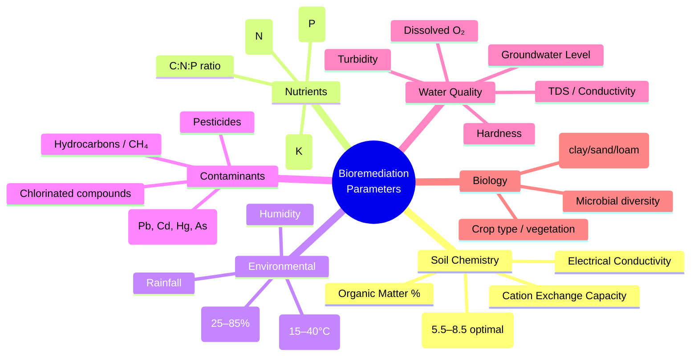
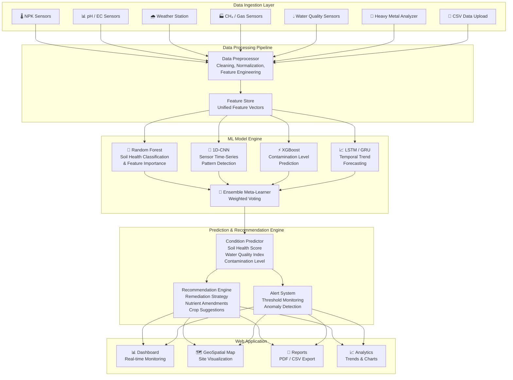
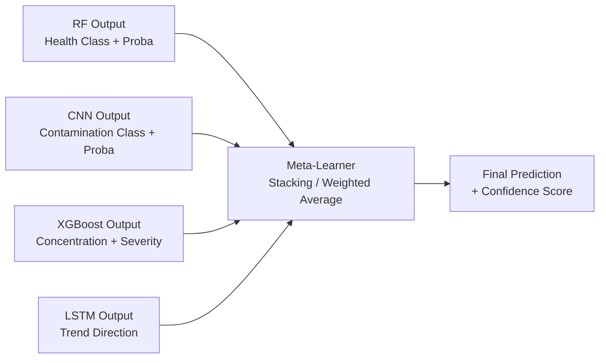
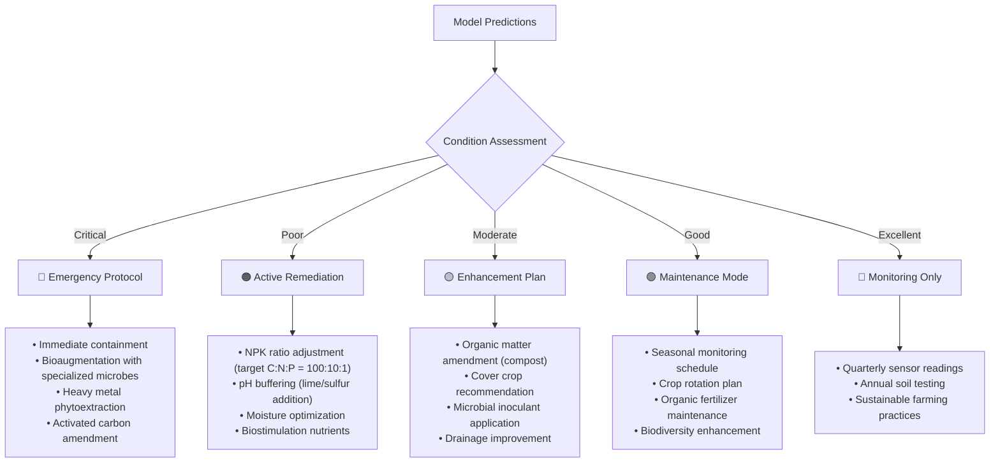

# Bioremediation Intelligence Platform — Implementation Plan

## 1. Bioremediation: Concept Overview

**Bioremediation** is the process of using living organisms (bacteria, fungi, plants) to degrade, detoxify, or neutralize environmental contaminants from soil, water, and sediments. It is a cost-effective, sustainable alternative to physical/chemical remediation methods.

### Key Bioremediation Strategies

| Strategy | Mechanism | Target Contaminants |
|---|---|---|
| **Biostimulation** | Adding nutrients (N, P, K) to stimulate indigenous microbes | Hydrocarbons, heavy metals |
| **Bioaugmentation** | Introducing specialized microorganisms | Pesticides, chlorinated solvents |
| **Phytoremediation** | Using plants to absorb/degrade pollutants | Heavy metals (Pb, Cd, As, Hg) |
| **Mycoremediation** | Using fungi to break down contaminants | PAHs, petroleum, dyes |
| **Composting** | Controlled decomposition of organic waste | Organic pollutants |
| **Bioventing** | Stimulating aerobic degradation in soil | Fuel hydrocarbons |

### Critical Parameters That Govern Bioremediation



---

## 2. Available Data Analysis

We have **17 datasets** totaling ~280MB across 4 domains. Here is how each maps to the bioremediation pipeline:

### 2.1 Soil Data (Core Input)

| Dataset | Rows | Key Columns | Role in System |
|---|---|---|---|
| [soil_data.csv](file:///d:/bioremediation%20site/coding_1/extracted_data/soil_data.csv) | 1,000,000 | Lat, Long, Depth, Texture, pH, Organic_Matter_%, Moisture_%, Bulk_Density, **N, P, K (ppm)**, CEC, EC, Soil_Color, Porosity, Water_Holding_Capacity | **Primary input** — soil health baseline, nutrient levels, physical properties |
| [data_core.csv](file:///d:/bioremediation%20site/coding_1/extracted_data/data_core.csv) | 8,000 | Temperature, Humidity, Moisture, Soil Type, Crop Type, **Nitrogen, Potassium, Phosphorous**, Fertilizer Name | Fertilizer recommendation training, nutrient-to-crop mapping |

### 2.2 Pollution & Contamination Data

| Dataset | Rows | Key Columns | Role in System |
|---|---|---|---|
| [soil_pollution_diseases.csv](file:///d:/bioremediation%20site/coding_1/extracted_data/soil_pollution_diseases.csv) | 3,000 | Pollutant_Type, **Pollutant_Concentration_mg_kg**, Soil_pH, Temp, Humidity, Rainfall, Crop_Type, Nearby_Industry, **Disease_Type, Disease_Severity**, Mitigation_Measure | **Contamination classification** — predict severity & recommend mitigation |

### 2.3 Water Quality Data

| Dataset | Rows | Key Columns | Role in System |
|---|---|---|---|
| [water_potability.csv](file:///d:/bioremediation%20site/coding_1/extracted_data/water_potability.csv) | 3,276 | pH, Hardness, Solids, Chloramines, Sulfate, Conductivity, Organic_carbon, Trihalomethanes, Turbidity, **Potability** | Water safety classification |
| Ground Water 2012–2021 (8 files) | ~10,800 total | Station, State, Temp Min/Max, pH Min/Max, Conductivity Min/Max, Year | Temporal groundwater monitoring |
| ground_water_quality_2018–2020_post (3 files) | ~1,100 total | District, Lat, Long, GWL, pH, EC, TDS, CO3, HCO3, Cl, F, NO3, SO4, Na, K, Ca, Mg, T.H, SAR, Classification | **Detailed water chemistry** — contamination indicator |

### 2.4 Crop & Agriculture Data

| Dataset | Rows | Key Columns | Role in System |
|---|---|---|---|
| [Crop_recommendation.csv](file:///d:/bioremediation%20site/coding_1/extracted_data/Crop_recommendation.csv) | 2,200 | **N, P, K**, Temperature, Humidity, pH, Rainfall, **Label (crop)** | Post-remediation crop recommendation |

---

## 3. System Architecture



---

## 4. ML Model Design

### 4.1 Model 1 — Random Forest (Soil Health Classification)

> **Purpose**: Classify overall soil health condition and identify most important features driving remediation success.

| Aspect | Detail |
|---|---|
| **Input Features** | N, P, K, pH, Organic_Matter, Moisture, Bulk_Density, EC, CEC, Texture (encoded), Temperature, Humidity |
| **Target** | Soil_Health_Score (engineered: 0–100 scale from composite of features) |
| **Training Data** | `soil_data.csv` (1M rows), `data_core.csv`, `Crop_recommendation.csv` |
| **Why RF** | Handles mixed feature types, provides **feature importance** ranking, robust to outliers, no scaling needed |
| **Output** | Health classification (Critical / Poor / Moderate / Good / Excellent) + top-5 factors needing intervention |

```python
# Pseudocode
from sklearn.ensemble import RandomForestClassifier

features = ['N', 'P', 'K', 'pH', 'Organic_Matter', 'Moisture', 
            'Bulk_Density', 'EC', 'CEC', 'Temperature', 'Humidity']

# Engineer target: composite soil health score
df['Soil_Health_Score'] = compute_health_score(df[features])
df['Health_Class'] = pd.cut(df['Soil_Health_Score'], bins=5, 
                            labels=['Critical','Poor','Moderate','Good','Excellent'])

rf = RandomForestClassifier(n_estimators=300, max_depth=20, class_weight='balanced')
rf.fit(X_train, y_train)

# Feature importance → drives recommendations
importances = rf.feature_importances_
```

### 4.2 Model 2 — 1D-CNN (Sensor Pattern Detection)

> **Purpose**: Detect spatial/temporal patterns in multi-sensor readings that indicate contamination or degradation.

| Aspect | Detail |
|---|---|
| **Input** | Sliding window of sensor readings (shape: [batch, timesteps, n_sensors]) |
| **Target** | Contamination classification (Clean / Low / Moderate / High / Severe) |
| **Training Data** | `soil_pollution_diseases.csv`, `ground_water_quality_*.csv`, `water_potability.csv` |
| **Why CNN** | Captures local patterns across sensor channels, translation-invariant feature detection |
| **Output** | Contamination class + spatial heatmap of activation |

```python
# Pseudocode - PyTorch
import torch.nn as nn

class BioremediationCNN(nn.Module):
    def __init__(self, n_sensors=12, n_classes=5):
        super().__init__()
        self.conv1 = nn.Conv1d(n_sensors, 64, kernel_size=3, padding=1)
        self.bn1 = nn.BatchNorm1d(64)
        self.conv2 = nn.Conv1d(64, 128, kernel_size=3, padding=1)
        self.bn2 = nn.BatchNorm1d(128)
        self.conv3 = nn.Conv1d(128, 256, kernel_size=3, padding=1)
        self.pool = nn.AdaptiveAvgPool1d(1)
        self.fc = nn.Sequential(
            nn.Linear(256, 128), nn.ReLU(), nn.Dropout(0.3),
            nn.Linear(128, n_classes)
        )
    
    def forward(self, x):
        x = F.relu(self.bn1(self.conv1(x)))
        x = F.relu(self.bn2(self.conv2(x)))
        x = F.relu(self.conv3(x))
        x = self.pool(x).squeeze(-1)
        return self.fc(x)
```

### 4.3 Model 3 — XGBoost (Contamination Level Prediction)

> **Purpose**: Predict precise contamination concentration (mg/kg) and disease severity from environmental parameters.

| Aspect | Detail |
|---|---|
| **Input** | Pollutant_Type, Soil_pH, Temperature, Humidity, Rainfall, Nearby_Industry, Soil_Texture, Soil_Organic_Matter |
| **Target** | Pollutant_Concentration_mg_kg (regression) AND Disease_Severity (classification) |
| **Training Data** | `soil_pollution_diseases.csv` (3K rows) |
| **Why XGBoost** | Superior for tabular regression, handles missing values, built-in regularization |
| **Output** | Predicted contamination level + severity class + SHAP explanations |

### 4.4 Model 4 — LSTM (Temporal Forecasting)

> **Purpose**: Forecast future soil/water quality trends from historical groundwater monitoring data.

| Aspect | Detail |
|---|---|
| **Input** | Time-series of pH, EC, TDS, NO3, heavy metals over years (2012–2021) |
| **Target** | Next-period water quality parameters |
| **Training Data** | Ground Water 2012–2021 (10K+ rows), ground_water_quality post-monsoon series |
| **Why LSTM** | Captures long-term temporal dependencies in environmental monitoring data |
| **Output** | Forecast curves + confidence intervals + trend direction (improving/degrading) |

### 4.5 Ensemble Meta-Learner



---

## 5. Recommendation Engine Logic

The system generates actionable recommendations based on model outputs:



### Recommendation Rules (from data)

| Condition | Trigger | Recommendation | Source Dataset |
|---|---|---|---|
| Low N (<50 ppm) | `soil_data.csv` N column | Add urea/ammonium sulfate, legume cover crop | `data_core.csv` fertilizer mapping |
| pH < 5.5 | `soil_data.csv` pH column | Apply agricultural lime (CaCO₃) at 2–4 t/ha | `Crop_recommendation.csv` pH ranges |
| pH > 8.5 | `soil_data.csv` pH column | Apply elemental sulfur or gypsum | `Crop_recommendation.csv` |
| High Pb (>150 mg/kg) | `soil_pollution_diseases.csv` | Phytoremediation with sunflower/mustard, soil capping | Mitigation_Measure column |
| Low moisture (<15%) | `soil_data.csv` Moisture | Mulching, drip irrigation, organic matter amendment | `data_core.csv` |
| High NO₃ in water | `ground_water_quality_*.csv` | Denitrification bioreactor, constructed wetland | Water quality thresholds |
| Water non-potable | `water_potability.csv` | Activated carbon filtration, UV treatment | Potability=0 cases |
| Post-remediation | Model output "Good" | Recommend crop from `Crop_recommendation.csv` matching soil NPK/pH | Crop label column |

---

## 6. Proposed Technology Stack

| Layer | Technology | Justification |
|---|---|---|
| **Frontend** | HTML/CSS/JS (Vanilla) with Chart.js, Leaflet.js | Rich dashboard, geospatial mapping, no framework overhead |
| **Backend API** | Python Flask/FastAPI | Serve ML models, handle sensor data ingestion |
| **ML Training** | scikit-learn, XGBoost, PyTorch | Industry-standard ML libraries |
| **Database** | SQLite (dev) → PostgreSQL (prod) | Sensor time-series + model results storage |
| **Data Processing** | pandas, numpy | Feature engineering pipeline |
| **Visualization** | Chart.js (charts), Leaflet.js (maps), D3.js (custom) | Interactive, real-time dashboards |

---

## 7. Proposed File Structure

```
bioremediation-platform/
├── index.html                    # Main dashboard SPA
├── index.css                     # Design system & styles
├── js/
│   ├── app.js                    # Main application controller
│   ├── dashboard.js              # Dashboard charts & widgets
│   ├── map.js                    # Geospatial visualization
│   ├── prediction.js             # Prediction form & results
│   └── recommendations.js        # Recommendation display
├── api/
│   ├── server.py                 # Flask/FastAPI server
│   ├── models/
│   │   ├── random_forest.py      # RF model training & inference
│   │   ├── cnn_model.py          # 1D-CNN model
│   │   ├── xgboost_model.py      # XGBoost model
│   │   ├── lstm_model.py         # LSTM forecasting model
│   │   └── ensemble.py           # Meta-learner ensemble
│   ├── preprocessing/
│   │   ├── data_pipeline.py      # Data cleaning & feature engineering
│   │   ├── feature_store.py      # Unified feature vector builder
│   │   └── sensor_ingestion.py   # Real-time sensor data handler
│   └── recommendation/
│       ├── engine.py             # Rule-based + ML recommendation
│       └── crop_advisor.py       # Post-remediation crop suggestion
├── extracted_data/               # Raw datasets (existing)
├── models/                       # Saved trained models (.pkl, .pt)
├── docs/
│   ├── architecture.md           # Full architecture documentation
│   └── api_reference.md          # API endpoint documentation
└── requirements.txt              # Python dependencies
```

---

## 8. Implementation Phases

### Phase 1: Data Pipeline & Feature Engineering
- [ ] Unify all 17 CSVs into a common schema
- [ ] Engineer composite soil health score
- [ ] Handle missing values, encode categoricals
- [ ] Create train/val/test splits

### Phase 2: Model Training
- [ ] Train Random Forest on soil health classification
- [ ] Train XGBoost on contamination prediction
- [ ] Train 1D-CNN on multi-sensor pattern detection
- [ ] Train LSTM on temporal water quality forecasting
- [ ] Build ensemble meta-learner

### Phase 3: Backend API
- [ ] Build Flask/FastAPI server with prediction endpoints
- [ ] Implement sensor data ingestion API
- [ ] Build recommendation engine with rule + ML hybrid
- [ ] Add model versioning and experiment tracking

### Phase 4: Frontend Dashboard
- [ ] Build responsive dashboard with real-time charts
- [ ] Implement geospatial map with Leaflet.js
- [ ] Create prediction input form with sensor data fields
- [ ] Build recommendation display with actionable cards
- [ ] Add historical trend visualization

### Phase 5: Integration & Polish
- [ ] End-to-end sensor → prediction → recommendation pipeline
- [ ] Alert/notification system for critical conditions
- [ ] PDF report generation
- [ ] Performance optimization

---

## User Review Required

> [!IMPORTANT]
> **Scope Decision**: This is a large system. Please confirm if you want me to build:
> - **Option A**: Full working prototype (all phases, simpler models, functional web app)
> - **Option B**: Documentation + Architecture only (detailed docs, pseudocode, diagrams)
> - **Option C**: Frontend-only demo (beautiful web dashboard with mock data + model stubs)

> [!IMPORTANT]
> **Model Priority**: Which models should I focus on first?
> 1. Random Forest (soil health classification) — fastest to train, most interpretable
> 2. XGBoost (contamination prediction) — best for tabular data
> 3. CNN (sensor patterns) — needs more data engineering
> 4. LSTM (temporal forecasting) — needs temporal feature engineering

## Open Questions

> [!WARNING]
> **Real-time Sensors**: The datasets are static CSVs. Should the system:
> - Accept manual data entry through a web form?
> - Simulate real-time sensor feeds for demo purposes?
> - Have an API endpoint ready for future IoT sensor integration?

> [!NOTE]
> **CH₄ / Gas Data**: None of the current datasets contain methane (CH₄) or greenhouse gas measurements. The system architecture includes CH₄ sensor inputs, but we would need to either:
> - Generate synthetic CH₄ data based on soil organic matter decomposition models
> - Add a placeholder column with the sensor integration API ready
> - Source an additional CH₄/biogas dataset

## Verification Plan

### Automated Tests
- Model accuracy metrics: F1-score, RMSE, R², confusion matrices
- Cross-validation on all models (5-fold)
- API endpoint testing with sample payloads
- Frontend responsive design testing across viewports

### Manual Verification
- Visual inspection of dashboard charts and map
- End-to-end prediction flow: input data → model → recommendation
- Recommendation quality review against domain knowledge


---

# Implementation Plan — Assessment Form Input Validation Fix

## [Overview]
Fix the assessment form so that **any** numeric value (e.g., Phosphorus `15.98`, Latitude `23.787456`) can be entered and submitted. Currently every `<input type="number">` in `index.html` carries a hard `step` constraint (`0.1`, `0.01`, `0.0001`, or `1`). The browser's native constraint validation rejects values not aligned to that step grid — showing *"Please enter a valid value. The two nearest valid values are 15.9 and 16"* — and the `submit` event never fires, so `js/app.js`'s submit handler never runs and no assessment is generated.

The trigger is not random: both helper buttons populate the form with values that violate the step grid —
- **"Load Nearest Village Soil"** (`applyBardhamanSite` in `js/app.js`) writes raw dataset values such as `p = 15.98`, `n = 107.46` into `step="0.1"` fields.
- **"Use Current Location"** writes `position.coords.latitude.toFixed(6)` (e.g., `23.787456`) into `step="0.0001"` fields.

**Chosen approach (user-confirmed):** replace every `step` constraint with `step="any"` on all number inputs in the assessment form. This accepts arbitrary decimals while preserving the rest of native validation. The backend (`api/server.py` → feature store) accepts any float and needs no changes.

## [Types]
No type system changes. Payload construction in `js/prediction.js` (`formToPayload`) already coerces numeric strings via `Number(value)` and remains unchanged.

## [Files]
| File | Change |
|---|---|
| `/run/media/deb/New Volume/bioremediation site/coding_2/index.html` | **Modify** — on all 16 `<input type="number">` elements inside `#assessment-form` (lines 61–66, 80–84, 88–90, 102–103), replace `step="0.1"`, `step="0.01"`, `step="1"`, and `step="0.0001"` with `step="any"`. No other HTML changes. |
| `/run/media/deb/New Volume/bioremediation site/coding_2/js/app.js` | **No change required.** `setField()` writes raw values (`features.p = 15.98`, `toFixed(6)` coordinates) which now validate cleanly against `step="any"`. |
| `/run/media/deb/New Volume/bioremediation site/coding_2/js/prediction.js` | **No change.** |
| `/run/media/deb/New Volume/bioremediation site/coding_2/api/server.py` | **No change.** Backend already accepts arbitrary floats. |

## [Functions]
No functions added, modified, or removed. Verification only touches behavior of:
- `formToPayload(form)` — `js/prediction.js:1` (unchanged; now receives previously-rejected values).
- `form.addEventListener("submit", ...)` — `js/app.js:116` (submit event now fires for arbitrary decimals).
- `applyBardhamanSite(result)` — `js/app.js:50` (populated values no longer invalidate the form).
- `useCurrentLocation()` — `js/app.js:80` (6-decimal coordinates no longer invalidate the form).

## [Classes]
None. The project uses plain HTML/ES-module JS and a Python stdlib HTTP server; no classes are affected.

## [Dependencies]
None added, removed, or version-changed.

## [Testing]
1. **Static check:** `grep -n 'step="' index.html` must return zero matches after the edit (all replaced by `step="any"`).
2. **Manual regression (browser):**
   - Start API: `python api/server.py`; open the served page.
   - Prediction view → type `15.98` into Phosphorus ppm and arbitrary decimals into N, K, pH, lat/long → click **Assess Site** → assessment report and result cards must render (no step-mismatch popup).
   - Click **Load Nearest Village Soil** → form fills with dataset values (e.g., `107.46`, `15.98`) → **Assess Site** must submit successfully.
   - Click **Use Current Location** → coordinates with 6 decimals fill the form → **Assess Site** must submit successfully.
   - Click **Run Sample Assessment** and **Send Sensor Event** → both must still work (unchanged code paths).
3. **Negative check:** leaving a field empty still yields `""` → `formToPayload` keeps it as a string; backend behavior unchanged (same as before the fix).

## [Implementation Order]
1. Edit `index.html`: replace all 16 `step="..."` attributes with `step="any"` (single mechanical pass across lines 61–103).
2. Run the static grep check to confirm no `step="` constraints remain.
3. Manual browser regression per the Testing section (requires the API running for `/api/predict`).
4. Done — no follow-up changes needed in JS or Python layers.

---

# Implementation Plan — Heavy-Metal Danger Alert Fix (v2 scope)

## [Overview]
Make the system actually surface danger when heavy-metal contamination is high. Currently, danger is suppressed at two levels:
1. **Backend dilution** (`api/models/ensemble.py`): contamination carries only 40% weight (max contribution 1.6), but "Poor" needs risk ≥ 2.4 and "Critical" ≥ 3.25 — so even **Severe** contamination alone can *never* yield a danger classification. Verified live: Lead 250 mg/kg → contamination "High" but overall **"Good"**; Lead 500 mg/kg → "Severe" but overall only **"Moderate"**. Because `api/recommendation/engine.py` gates "Start active remediation" on overall Critical/Poor, severe sites get no remediation urgency.
2. **Frontend silence** (`js/prediction.js` + `index.css`): the score ring is colored only by `soil_health.score`, so a Severe-lead site with good nutrients shows a **green ring**; contamination/water/overall classes are plain unstyled text badges; no alert banner exists.

Additionally, housekeeping: `requirements.txt` is all comments and the root `.venv` is a broken Windows venv on this Linux machine (`api/.venv`, Python 3.14, works). A server instance is already running on port 8000 and must be **restarted** after backend changes.

**Approach:** add a hazard override in the ensemble (Severe contamination → overall at least "Critical"; High → at least "Poor"), slightly tighten the Lead screening thresholds, add a color-coded danger banner + colored status badges in the frontend, and fix the dependency documentation.

## [Types]
No new types. Reuses existing class vocabularies: `["Clean","Low","Moderate","High","Severe"]` (contamination), `["Critical","Poor","Moderate","Good","Excellent"]` (soil/ensemble), `RISK_INDEX` in `api/models/ensemble.py`.

## [Files]
| File | Change |
|---|---|
| `/run/media/deb/New Volume/bioremediation site/coding_2/api/models/ensemble.py` | **Modify** — in `EnsembleModel.predict`, after computing the weighted `final` class, apply a contamination hazard override: `contamination["class"] == "Severe"` forces overall ≥ "Critical"; `"High"` forces overall ≥ "Poor". Implement via an ordered rank list so the override never *lowers* the weighted result. |
| `/run/media/deb/New Volume/bioremediation site/coding_2/api/models/xgboost_model.py` | **Modify** — tighten `POLLUTANT_THRESHOLDS["lead"]` from `[50, 100, 150, 300]` to `[40, 80, 150, 300]` so 95 mg/kg (form default, above common screening values) classifies "Moderate" instead of "Low". Other pollutants left unchanged (already domain-calibrated). |
| `/run/media/deb/New Volume/bioremediation site/coding_2/api/recommendation/engine.py` | **No change required** — it already emits "Deploy contaminant-specific treatment" for High/Severe contamination, and will now also emit "Start active remediation" once the ensemble escalates. |
| `/run/media/deb/New Volume/bioremediation site/coding_2/js/prediction.js` | **Modify** — in `renderPredictionSummary`: (a) add a danger banner `<div class="alert-banner ...">` when `result.contamination.class` is High/Severe or `result.ensemble.class` is Critical/Poor, showing pollutant, concentration, class, and recommended action; (b) color-code each status badge (soil/contamination/water/overall) by severity using new CSS classes; (c) drive the score-ring color from the *overall/contamination* severity, not only `soil_health.score`. |
| `/run/media/deb/New Volume/bioremediation site/coding_2/index.css` | **Modify** — add styles: `.alert-banner` (critical red and warning amber variants), severity-colored badge variants, matching the existing design-system tokens used by `.badge`, `.primary-action`, etc. |
| `/run/media/deb/New Volume/bioremediation site/coding_2/requirements.txt` | **Modify** — replace commented file with accurate content: runtime needs **no third-party packages** (Python stdlib only); optional `pandas`/`openpyxl` (commented) only for regenerating `extracted_data/bardhaman_village_soil_normalized.csv`. |
| `/run/media/deb/New Volume/bioremediation site/coding_2/README.md` | **Modify (small)** — add a "Run" note: use `api/.venv/bin/python api/server.py` (or any system `python3` — stdlib only); the root `.venv` is a Windows venv and should be deleted or ignored on Linux. |

## [Functions]
- **Modified:** `EnsembleModel.predict(soil, contamination, sensor, trend)` — `api/models/ensemble.py:23`. Add hazard-override step after the weighted threshold chain. Signature unchanged; output dict shape unchanged (class / risk_score / confidence), so the frontend and server need no contract changes.
- **Modified:** `renderPredictionSummary(target, result)` — `js/prediction.js:10`. Add danger banner + severity-colored badges. Signature unchanged.
- **Unchanged:** `build_recommendations` (`api/recommendation/engine.py:6`), `ContaminationModel.predict` (`api/models/xgboost_model.py:20`, thresholds constant only), `make_prediction` (`api/server.py:33`).

## [Classes]
- **Modified:** `EnsembleModel` — `api/models/ensemble.py` — add module-level `CLASS_RANK` ordered list and a small `_escalate(final, contamination_class)` helper; no inheritance changes.
- No classes added or removed.

## [Dependencies]
- **Runtime:** none — backend is pure Python stdlib (verified: the server already runs on port 8000).
- **Optional/dev:** `pandas`, `openpyxl` remain commented in `requirements.txt` (Bardhaman CSV regeneration only).
- **Cleanup note:** root `.venv` (Windows `Scripts/` layout) is non-functional on Linux; document in README, deletion left to the user.

## [Testing]
1. **Backend regression (curl / direct Python):** after the edits, restart the server, then:
   - `POST /api/predict {"pollutant_type":"Lead","pollutant_concentration":500}` → ensemble must be **"Critical"** and recommendations must include both "Start active remediation" and "Deploy contaminant-specific treatment".
   - Lead 250 → ensemble at least **"Poor"**; Lead 95 → contamination "Moderate".
   - Healthy-site sanity: default payload (concentration 45) must still yield "Excellent"/"Good" overall (no false alarms).
   - Previously failing cases must now escalate monotonically (no case where contamination is Severe but overall is Good/Moderate).
2. **Frontend regression (browser):** Lead 500 → red danger banner visible with pollutant + concentration; badges color-coded; score ring no longer green for contaminated sites. Clean default site → no banner.
3. **Dependency check:** server imports and runs with stdlib only; `requirements.txt` accurately reflects this.
4. **Note:** the already-running server on port 8000 must be killed and restarted (`pkill -f api/server.py`, then `api/.venv/bin/python api/server.py`) or it keeps serving the old logic.

## [Implementation Order]
1. `api/models/ensemble.py` — add `CLASS_RANK` + hazard override in `predict`.
2. `api/models/xgboost_model.py` — tighten Lead thresholds.
3. Run backend regression (Testing step 1) via direct Python before touching the frontend.
4. `js/prediction.js` — danger banner + severity-colored badges + ring color driven by overall severity.
5. `index.css` — add `.alert-banner` and severity badge styles.
6. `requirements.txt` + README run instructions.
7. Restart the running server, rerun the curl regression, and verify the banner in the browser.

---

# Implementation Plan — React Frontend Rewrite (v3 scope) + Backend Danger Fix

## [Overview]
Heavily upgrade the frontend by rewriting it as a **React (Vite) SPA**. The React project lives in **`frontend/`** (source, tooling, `package.json`); its production build (HTML/JS/CSS) is emitted into **`static/`**, which `api/server.py` serves. This replaces the legacy root `index.html` / `index.css` / `js/` modules as the default UI (legacy files remain untouched for reference). The rewrite also bakes in both earlier fixes: all number inputs use `step="any"`, and the danger banner / severity-colored UI is built in from the start. The backend ensemble hazard override and Lead threshold fix are implemented as specified in the v2 scope. Environment verified: Node v22.22.1, npm 10.9.9, npm registry reachable.

## [Types]
- Shared JS util `frontend/src/lib/severity.js`: `SEVERITY_ORDER`, `severityColor(className)` mapping `Critical/Severe/High/Unsafe/Poor/Elevated` → red/amber tones and `Good/Moderate/Low/Stable/Watch/Clean` → green/amber tones; used by badges, banner, ring, and map markers.
- Reused API response shape unchanged (`soil_health`, `contamination`, `water_quality`, `sensor_pattern`, `ensemble`, `recommendations`, `crop_plan`).

## [Files]
**New — `frontend/` (React source):**
- `frontend/package.json` — deps: `react`, `react-dom`, `leaflet`, `react-leaflet`, `chart.js`, `react-chartjs-2`; devDeps: `vite`, `@vitejs/plugin-react`.
- `frontend/vite.config.js` — `base: './'`, `build.outDir: '../static'`, `emptyOutDir: true`.
- `frontend/index.html` — SPA entry.
- `frontend/src/main.jsx`, `frontend/src/App.jsx` — bootstrap, tab navigation, API status, shared state (latest report).
- `frontend/src/lib/api.js` — fetch helpers (`getSummary`, `getTrends`, `getSites`, `predict`, `sensorEvent`, `nearestSoil`).
- `frontend/src/lib/severity.js` — severity→color util.
- `frontend/src/components/Dashboard.jsx` — metric cards, NPK bar chart (chart.js), groundwater trend line chart.
- `frontend/src/components/PredictionForm.jsx` — assessment form with `step="any"` inputs, geolocation + nearest-village buttons, **danger banner** (High/Severe contamination or Critical/Poor overall), severity-colored badges, score ring.
- `frontend/src/components/SiteMap.jsx` — `react-leaflet` map, risk-colored circle markers, `invalidateSize` fix for the broken tile rendering seen in the old UI.
- `frontend/src/components/Reports.jsx` — JSON report viewer + export download.
- `frontend/src/styles.css` — modernized design system (dark sidebar, green primary, alert variants).

**New — `static/`** — Vite build output (`index.html`, `assets/*.{js,css}`), generated, served by the API.

**Modified:**
- `/run/media/deb/New Volume/bioremediation site/coding_2/api/server.py` — `serve_static` serves from `ROOT/static` (SPA entry `index.html`, hashed assets) with ROOT fallback for legacy paths.
- `/run/media/deb/New Volume/bioremediation site/coding_2/api/models/ensemble.py` — hazard override (v2 scope).
- `/run/media/deb/New Volume/bioremediation site/coding_2/api/models/xgboost_model.py` — Lead thresholds `[40, 80, 150, 300]` (v2 scope).
- `/run/media/deb/New Volume/bioremediation site/coding_2/requirements.txt`, `README.md` — dependency + run docs (v2 scope).

**Untouched:** legacy root `index.html`, `index.css`, `js/` (kept for reference; no longer the default page).

## [Functions / Classes]
- Backend: `EnsembleModel.predict` gains `_escalate` (class-level helper); `ContaminationModel.predict` unchanged except thresholds constant. Frontend: React function components as listed; legacy `js/app.js` etc. remain but are unused by the new UI.

## [Dependencies]
- `frontend/package.json`: react@^18, react-dom@^18, leaflet@^1.9, react-leaflet@^4, chart.js@^4, react-chartjs-2@^5; dev: vite@^5, @vitejs/plugin-react@^4. Python runtime: stdlib only (no change).

## [Testing]
1. Backend regression via direct Python: Lead 500 → ensemble "Critical" + both remediation recommendations; Lead 250 → ≥ "Poor"; Lead 95 → contamination "Moderate"; clean defaults → "Excellent"/"Good" (no false alarms).
2. `npm run build` succeeds and emits `static/index.html` + hashed assets.
3. Server integration: `GET /` returns the React SPA; `GET /assets/*` hashed files 200; `POST /api/predict` Lead 500 → "Critical"; legacy root `index.html` still reachable via direct path.
4. Browser check: all four tabs functional, map tiles render fully (no gray void), danger banner shows for Lead 500, form accepts arbitrary decimals (e.g., 15.98).

## [Implementation Order]
1. Backend: ensemble override + Lead thresholds → run direct-Python regression. ✅ **Done — all 5 cases pass.**
2. Scaffold `frontend/` (package.json, vite config, entry) → `npm install`. ✅ **Done.**
3. Write React components + styles. ✅ **Done.**
4. `npm run build` → verify `static/`. ✅ **Done — emits hashed assets.**
5. Update `api/server.py` static serving. ✅ **Done — serves `static/` with ROOT fallback.**
6. Start server, run integration regression (curl), update `requirements.txt`/`README.md` and this plan's status. ✅ **Done — React SPA at `/`, assets 200, Lead 500 → Severe/Critical + both remediation recs, Lead 250 → Poor, clean site → no false alarm, legacy `index.html` still served via fallback.**

4. Done — no follow-up changes needed in JS or Python layers.
